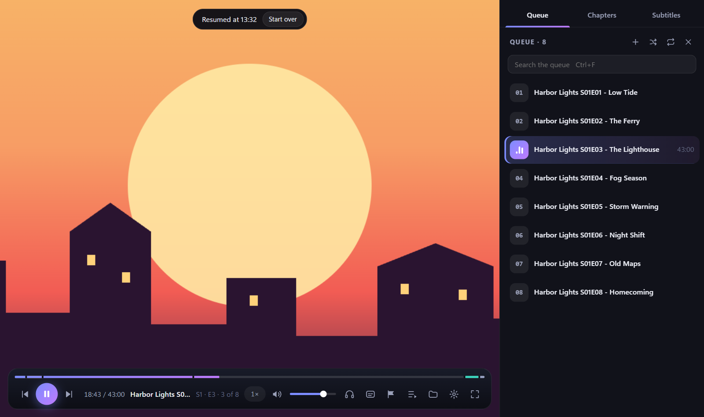
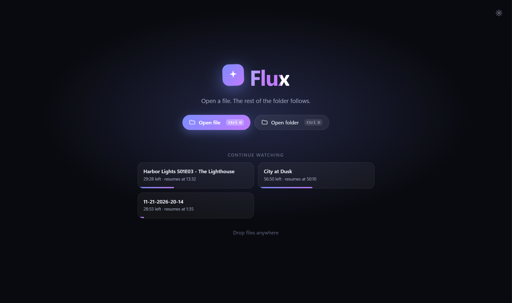
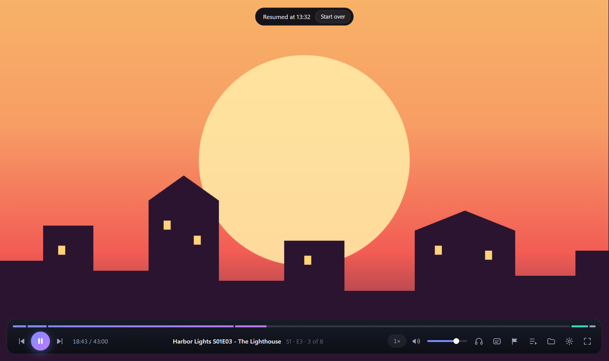
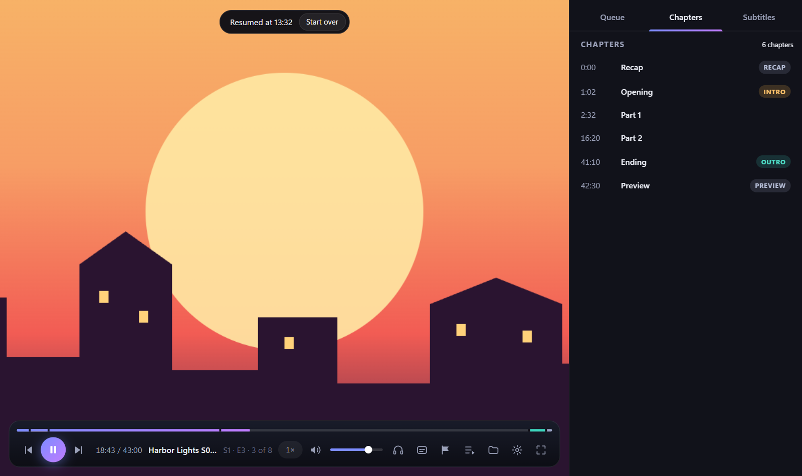

# Flux (Tauri + mpv, Windows)

A player, not a library: open a file, it plays at once, the rest of the folder queues up behind it. No library setup, no indexing, no database
(settings, history, resume positions, per-show choices are small JSON files in `%APPDATA%\local.flux\`; the app works without them).



Playback is **mpv** drawn into a child window over the web UI, controlled over mpv's JSON pipe. The controls float on the picture: the page
cuts a rounded hole in mpv's window under each visible overlay (`host_rect` cuts), so the video never resizes. Rust (`src-tauri/src/lib.rs`)
starts mpv (right at launch when opened with a file, before the web view has loaded), forwards commands, lists folders, reads durations,
makes thumbnails, runs Whisper, saves clips, recycles files and registers media keys. Everything else is `src/`.

## How it works

| | |
|---|---|
|  |  |
| **1. Open a file** (or a folder, or pick up from Continue watching). It starts playing at once and resumes where you stopped. | **2. The controls float on the picture** and hide after 3 s. The seek bar shows chapters and intro/outro bands. |
|  |  |
| **3. The folder queues up behind it.** Episodes of the same show are found and put in order (Q opens the queue). | **4. Skip what you don't need.** Chapters (C) are tagged Recap, Intro, Outro and Preview, and intros can be skipped automatically. |

The show and files in these screenshots are made up.

## Download
The installer is on the [Releases](https://github.com/JustSad42/flux/releases/latest) page (`Flux_<version>_x64-setup.exe`). Installed copies
check for a new version a few seconds after they start and offer it in a message; Settings → Check for updates does it by hand.

## Install the build tools (once)
`.\setup-windows.ps1` (Rust, Node, VS C++ build tools, mpv via winget), reopen PowerShell. Flux finds mpv itself (PATH, then the usual install folders).

## Make the installer
`.\build-installer.ps1` builds `Flux-Setup.exe`: one file to send to anyone. It carries its own mpv, installs for the current user (no admin prompt), adds a Start menu entry, lists Flux under "Open with" for video/audio files (it never changes your default player; pick Flux as default in Windows Settings → Default apps if you want it), and uninstalls from Settings → Apps. The first run of Windows SmartScreen warns about unsigned apps: More info → Run anyway.

## Run
```
npm install
npx tauri icon app-icon.png      # once
npm run tauri dev                # or: npx tauri build --debug --no-bundle  -> src-tauri\target\debug\flux.exe
npm run tauri build
```
`npm test` runs the name-matching, queue, subtitle, marker and resume tests (no Windows needed). `npm run check` typechecks.
`cargo test` (in `src-tauri`) tests the subtitle clean-up.

## Release
`.\release.ps1 1.2.1 "What changed"` bumps the version in the three files, builds the installer signed with the updater key
(`~\.tauri\flux.key`, never in the repo: without it installed copies cannot update), writes `latest.json`, commits, tags, pushes and
creates the GitHub release with the installer, its `.sig` and `latest.json`. The updater reads
`https://github.com/JustSad42/flux/releases/latest/download/latest.json` and installs in passive mode (a small progress window, no questions).
mpv is not in the repo (124 MB): `build-installer.ps1` copies it from the installed mpv into `src-tauri/resources/mpv` on the first build.

## What it does
- **Folder queue** (`src/queue/`): opening a file starts playback first; the folder is listed in the background and episodes of the same show are queued
  in natural order (`Episode 01`, `S01E01`, `Show - 01`, `001 - Title`, `Part 1`, `Disc 1` …). Recordings named by date and time (`11-22-2026-07-06`,
  `2026-11-22 07-06-00`, `Game 2026.11.22 - 07.06.00.01`, `20261122_070600`) queue in time order. When nothing looks related, the whole folder is
  queued ("Queue the whole folder", on by default). Settings for sensitivity, subfolders, same media type, max size. Anything you add or move is never removed by discovery.
- **Controls**: a floating bar over the video that hides after 3 s without mouse movement (setting), also in fullscreen. Moving the
  pointer into the bottom fifth of the picture brings it up and keeps it up while the pointer stays there (`flux.lua` reports the pointer height).
- **Open a folder**: Ctrl+D, or right-click a folder (or the empty space inside one) in Explorer → **Play with Flux**: everything in it, from the top.
- **Background**: closing the window keeps Flux running hidden (setting, on by default), so the next video opens instantly; it draws nothing and uses no CPU while hidden. The tray icon is optional (Settings → Show the tray icon). Without it, open Flux from the Start menu or a video to bring it back, and quit with Ctrl+Q or Settings → Quit Flux. **Start with Windows** (off by default) starts it hidden at sign-in (`--background`). The window's size, position and maximized state are remembered.
- **Timeline**: a thin seek bar with chapter gaps, orange/teal intro/outro bands and the A-B mark. Pointing at it shows a preview frame and the time
  above the cursor (thumbnails made in the background with mpv after playback settles, cached). The accent colour follows the picture.
- **Chapters**: panel (C) with Intro/Outro/Preview tags; PageUp restarts the current chapter first, PageDown on the last chapter goes to the next file; no chapters = ±90 s.
- **Skip intro/outro**: from chapter names (OP/Opening/Intro, ED/Ending/Credits, Recap, Preview). With no chapters, press **I** once: Flux skips 85 s and remembers
  that window for the show; **O** near the end remembers the outro. Settings: off / ask (Skip button) / auto (with Undo).
- **Smart resume**: starts 3 s before where you stopped, "Start over" in the bar, files that are nearly finished start from 0, "Continue watching" cards on the home screen.
- **Subtitles**: the file that belongs to the episode (by episode number and season, also in `Subs`/`Subtitles` folders) is loaded in your preferred language; panel
  (U) lists tracks and matches. Audio/subtitle language choices are remembered per show.
- **Whisper subtitles**: **G** (or Subtitles panel → Generate) makes subtitles for what is playing, in the background; they turn on by themselves.
  Flux finds whisper.cpp on the PC (`%LOCALAPPDATA%\local.flux\whisper`, then LingoReel's download), picks the best model (large-v3-turbo first) and
  runs it on the GPU; language auto-detect by default. A Silero VAD model (`ggml-silero-*.bin`) in that folder turns on speech detection.
  Other presets: `whisper`/`faster-whisper`/`whisper-ctranslate2` CLIs, or a custom command with `{file} {outdir} {stem} {lang} {model}`.
  The `.srt` is written next to the video (`<name>.whisper.srt` if `<name>.srt` already exists).
- **Clips**: L at the start, L at the end, X (or "Save clip") offers three ways to save that part next to the video: **Fast copy** (no re-encode,
  starts on the keyframe at or before the mark), **Exact cut** (frame-exact, NVENC on the GPU, x264 if there is no NVIDIA card) and
  **Small for Discord** (about 8.5 MB whatever the length: 1080p for short clips, 720p, then 480p as the bitrate gets tight). The last choice is
  highlighted next time. With "Mix all tracks" on, the re-encoded clips carry the mix.
- **Audio menu** (headphones button, Shift+A): pick a track, **Mix all tracks** into one (game + voice chat + mic in recordings; remembered per
  folder/show; A goes back to single tracks) and **Even out loudness** (dynaudnorm: quiet voices up, loud bangs down; global).
- **Subtitle style & timing** (Subtitles panel): size, height on screen, dark box behind the text; timing ±0.1 s with Z / Shift+Z;
  Ctrl+← / Ctrl+→ jump to the previous / next line.
- **Zoom**: Ctrl+wheel zooms toward the pointer, drag to move around, 0 resets (also on every new file). A click without a drag is play/pause.
- **Seeking**: dragging on the seek bar pauses and follows the pointer with fast keyframe seeks (one in flight at a time), then lands on the
  exact frame when you let go; arrow keys seek exactly.
- **Queue search**: Ctrl+F (or the box above the queue), every word must match; Enter plays the first hit, Esc clears.
- **Recycle Bin**: Delete (twice, or the toast's button) moves the playing file to the Recycle Bin and plays the next one; the queue's trash button does the same for any item.
- **Frame step / slow motion**: `,` and `.` step one frame back/forward (pauses), 1 = 0.25×, 2 = 0.5×, 3 or Backspace = normal; the speed button opens a menu.
- **Also**: single window (a second launch hands its file to the first), durations of queued files (MP4 read directly), speed ([ ]), screenshots (Ctrl+S → `Pictures\Flux`), media keys.

## Keys
Space or click pause · ←/→ seek 5 s · ↑/↓ or wheel volume · N next · P previous · Q queue · C chapters · U subtitles · F or double-click fullscreen · M mute ·
A audio track · Shift+A audio menu · S subtitles cycle · G generate subtitles · Z / Shift+Z subtitle timing · Ctrl+← / Ctrl+→ previous / next line ·
I skip intro · O skip outro · [ ] speed · 1/2/3 0.25×/0.5×/1× · Backspace speed 1 · , . frame step · Ctrl+wheel zoom · 0 reset zoom ·
L A-B loop · X save clip · Delete Recycle Bin · PgUp/PgDn chapters · Ctrl+F search the queue · Ctrl+Q quit · Ctrl+O open · Ctrl+D folder · Ctrl+S screenshot.

## Testing
`FLUX_DATA=<folder>` runs a copy on separate settings/history/window position and without the single-window hand-off; give it its own `WEBVIEW2_USER_DATA_FOLDER` too.
mpv's own input can be driven over the pipe from the page (`mpv_cmd` with `mouse x y`, `keydown`/`keyup MBTN_LEFT`, `keypress Ctrl+f`):
that is how the bottom-edge, click/drag and key handling in `flux.lua` were tested.
`WEBVIEW2_ADDITIONAL_BROWSER_ARGUMENTS=--remote-debugging-port=<port>` lets a CDP script drive the page.

## Known limits
- **Media keys** are global hotkeys. If a browser tab (e.g. YouTube) is the active media session Windows may give the key to it instead of Flux.
- Dropping files on the video while playing is handled by mpv itself and adopted into the queue; dropping on the side panel adds to the queue.
- mpv's window sits above the web view; overlays are opaque holes cut into it (no see-through glass over the video). Dialogs hide the video while open.
- The early mpv start needs the key bindings saved by an earlier run (`input.conf` in the data folder), so the very first launch after install starts mpv the slower way.
- Learned intro/outro windows are the same time range in every episode of a show; chapter-based ones are exact.
- The turbo Whisper model cannot translate. Fast-copy clips start on a keyframe, so they can begin up to a couple of seconds before the A mark. Needs mpv 0.38+.
- Mixing all tracks uses mpv's `lavfi-complex`, which replaces the audio filter chain; loudness levelling is folded into the mix then.
